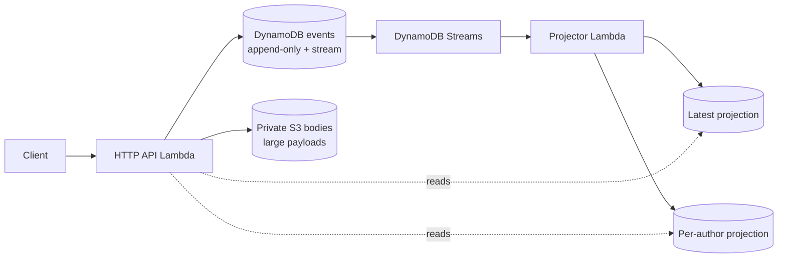
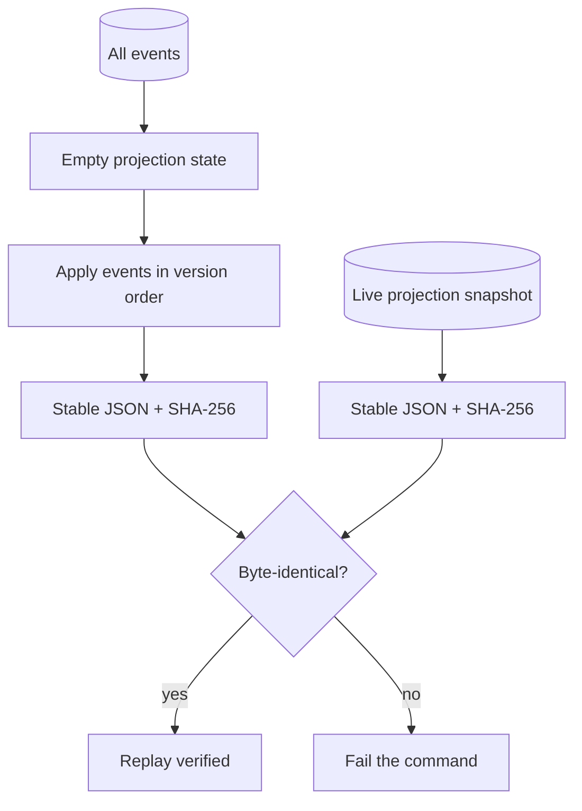

# event-sourced-knowledge-hub

This repository is a small event-sourcing example for a fictional Northwind Widgets knowledge team. The documents are synthetic runbooks and how-to notes written by invented authors such as `author-a` and `author-b`.

## Problem

A shared wiki is convenient, but a normal update can silently replace a useful runbook. That removes the history needed to understand what changed, who changed it, and which version was used during an incident. A wiki also becomes an easy place to paste credentials, private keys, bearer tokens, or database connection strings.

## Pattern

The write model stores facts as append-only document events. Each stream has an integer version, and a writer must provide the version it read. DynamoDB conditionally writes `(streamId, version)`, so concurrent writers cannot overwrite one another. A small ingest scanner rejects common credential-shaped content before it is persisted.

The read model is deliberately separate. Pure reducers build the latest document view and the per-author view. In AWS, a DynamoDB Streams Lambda applies new events to projection tables. Projection writes are conditional on a newer version and are therefore safe to replay. The API can also calculate a historical view by reducing events through an `asOf` timestamp.



### Write path and conflict

```mermaid
sequenceDiagram
  participant W1 as Writer 1
  participant API
  participant DDB as Events table
  participant W2 as Writer 2
  W1->>API: POST event, expectedVersion=3
  W2->>API: POST event, expectedVersion=3
  API->>DDB: conditional put stream/version=4
  DDB-->>API: 201 accepted
  API->>DDB: conditional put stream/version=4
  DDB-->>API: condition failed
  API-->>W2: 409 conflict; reload stream
```

### Replay



## Run locally

With Node 20 or newer installed, seed synthetic events, verify a deterministic replay, and run the tests with:

```sh
npm install && npm run seed && npm run replay && npm test
```

Start the local HTTP service with `npm run dev`; it uses the append-only JSONL event log in `data/events.jsonl` and rebuilds an in-memory projection at startup. LocalStack is optional and can be started with `docker compose up -d` when experimenting with AWS-compatible services.

Useful commands:

```sh
npm run lint       # strict TypeScript check
npm run typecheck  # strict TypeScript check
npm test
npm run seed
npm run replay
npm run tf-validate
```

## API examples

Create the first event in a stream:

```sh
curl -X POST http://localhost:3000/streams/runbook-demo/events \
  -H 'content-type: application/json' \
  -d '{"expectedVersion":0,"type":"DocumentCreated","author":"author-a","timestamp":"2026-02-01T09:00:00Z","body":"Synthetic Northwind Widgets runbook content."}'
```

Revise it using the version returned by the previous response:

```sh
curl -X POST http://localhost:3000/streams/runbook-demo/events \
  -H 'content-type: application/json' \
  -d '{"expectedVersion":1,"type":"DocumentRevised","author":"author-b","timestamp":"2026-02-02T09:00:00Z","body":"Synthetic revised runbook content."}'
```

Read the event history, latest document, historical document, or an author's documents:

```sh
curl http://localhost:3000/streams/runbook-demo/events
curl http://localhost:3000/documents/runbook-demo
curl 'http://localhost:3000/documents/runbook-demo?asOf=2026-02-01T12:00:00Z'
curl http://localhost:3000/authors/author-a/documents
```

A missing or stale `expectedVersion` returns `409`. A scanner match returns `422` and a rule id. There is no update or delete endpoint.

## Tradeoffs

- Projections are eventually consistent in the AWS deployment. The event stream is authoritative; a client that needs read-your-write behavior can read the stream or wait for the projection.
- Event schema evolution needs versioned schemas and upcasters. The MVP keeps one event shape and leaves an explicit place for that policy.
- Append-only storage grows forever. Production would add snapshots, archival tiers, and retention controls without losing the audit boundary.
- GDPR retraction conflicts with immutability. A retraction event hides a document from normal reads, while a production system would separately design encryption-key destruction, access controls, and legally required erasure semantics.
- DynamoDB, streams, Lambda, S3, and API Gateway are operationally simple at low volume but have ongoing request, storage, and observability costs.

## What I would do in production

I would use a schema registry with compatibility checks, explicit event versions and upcasters, stronger content inspection with a tested allow-list, KMS customer-managed keys, private networking, structured audit logs, alarms for projector lag and conditional-write conflicts, and a dead-letter path for poison events. I would add a query model for search, pagination and authorization, snapshot large streams, load test replay, and run LocalStack and contract tests in CI. Deployment would use immutable Lambda packages and a reviewed Terraform plan; the included deployment workflow is manual and assumes a preconfigured GitHub OIDC trust relationship.

The Terraform under `infra/` creates the event table, projection tables, private versioned encrypted S3 bucket, projector and API Lambda roles, event source mapping, HTTP API, and a GitHub OIDC deploy role. It uses placeholder names and IDs only; copy `infra/terraform.tfvars.example` and supply environment-specific values before applying.
